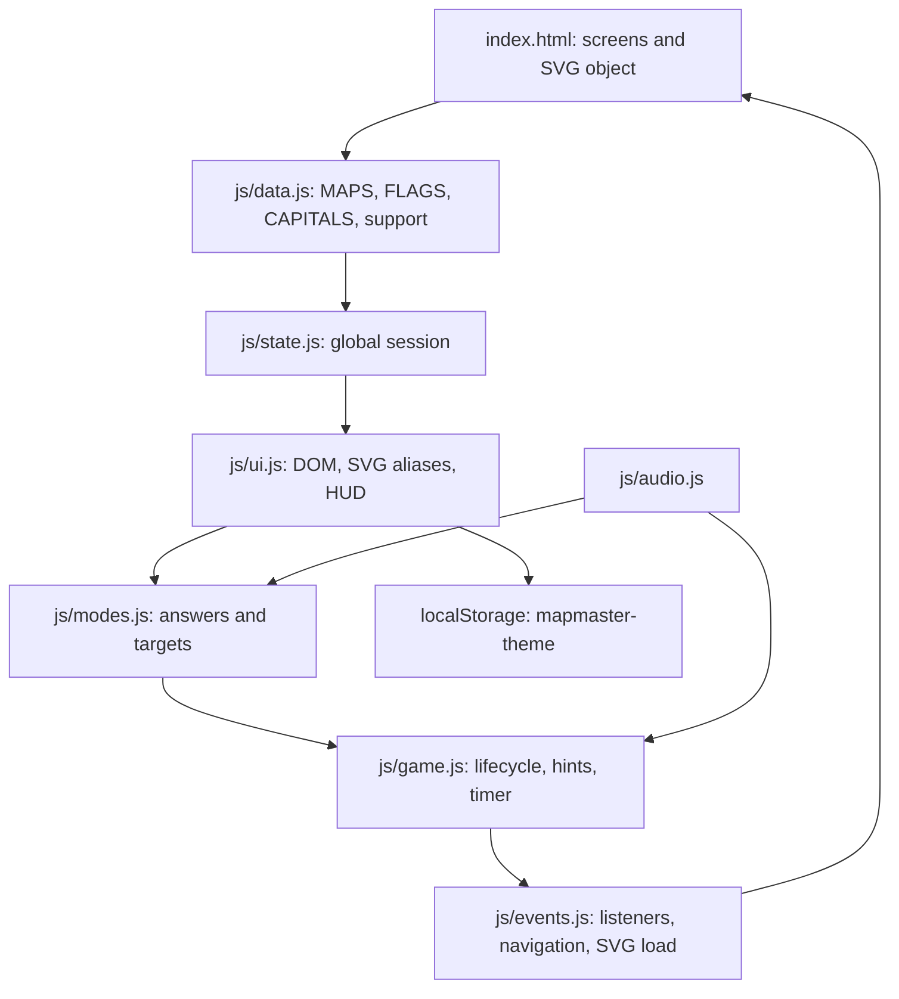

# Architecture and data flow

Arrows show a conceptual relationship, not a strict module import graph. HTML executes `data`, `state`, `audio`, `ui`, `modes`, `game`, `events` in that order. Function references are resolved at invocation, creating mutual dependencies across the latter three; changing script order breaks initialization. `css/variables.css`, `base.css`, `screens.css`, `game.css`, and `animations.css` define styling. Static SVGs total about 5.5 MB, world 1.2 MB; screenshots about 10 MB and are not loaded by app.

## Session

Selection → `applyMap` sets `CURRENT_REGIONS` and object data → selection handlers populate `gameState` → `startGame` resets, renders mode, chooses target and starts challenge interval → mode handler mutates score, attempts, streak, guessed arrays, HUD and map → `checkWin`/`endGame` → results/review. Typing has no target, flag and capital use subsets with data, locate chooses an unguessed region. Correct answers add one; India UT adds two bonus points. Challenge uses a decrementing one-second interval, and locate alone configures lives. Hint shows a character and subtracts ten seconds in challenge; locate hint is hidden. No skip control exists. Lose review lists remaining questions, not necessarily only wrong attempts.

`showScreen` uses delayed CSS transitions and global screen DOM; rapid transitions may race (unverified). `resetGame`, `applyMap`, and header restart clear game interval, but scheduled transitions/feedback animations are not centrally cancelled. Hero animation has a page-lifetime interval. Locate delegates click on the embedded document with remove/add; other document hover handlers are registered on load. SVGs load asynchronously; `getSvgDoc`, `getRegionName`, `SVG_ALIASES` and `getPathByName` bridge differing labels/IDs. Current lookup uses one matching element, potentially leaving multipart regions incomplete. Reverse aliases are global across maps and can translate continent names differently; verify per map. In-flight loads and starts merit browser race tests.

## Persistence and boundaries

`ui.js` reads `localStorage.getItem('mapmaster-theme')` during initialization; `events.js` writes `dark`/`light`. No parsing, schema, migration, saved progress or settings beyond theme exists. Storage exceptions may interrupt initialization. Sound is ephemeral. `innerHTML` is used for constants and bundled region strings; no direct raw-answer insertion identified. Any future remote/user content must use text nodes or sanitization. No server or secure competitive authority exists.

## Direction

Retain static delivery and DOM structure until behavior is covered. Extract deterministic data validation, exact normalized answer matching and a session reducer with explicit lifecycle, question pool and stop/cancellation ownership. Isolate SVG adapter with canonical IDs, one-to-many geometry and keyboard/list equivalent. Add versioned local save and guarded migration without deleting theme. Refactor screen transitions and listeners after characterization tests; replace ambiguous name-as-ID relationships, not the entire application. Defer accounts and competition until authority, privacy, demand and zero-cost feasibility are established.

## Follow-up map evidence

The scope-aware static path-name inventory is generated by `tools/audit-svg.py` into SVG_INVENTORY.md. It uses `getRegionName` attribute precedence and global aliases rather than the broader attribute-presence check from CP01. The difference exposes ten candidate targets with no matching path name and multipart/duplicate-ID ambiguity. It is not a DOM event or reachability test. One browser switching sequence showed a blank locate target and stale displayed world geometry; cause is unconfirmed (I-15).

## CP01 consolidation

Consolidation: architecture describes the audited versions overlaid onto the remote-based candidate. The extracted application’s historical relationship to the remote remains unknown; see BASELINE_COMPARISON.md.

## CP02 design foundation

The existing application adds `css/tokens.css`, `css/components.css` and `css/integration.css` after legacy styles. `design-system.html` loads its own `css/showcase.css` and isolated `js/showcase.js`; it does not load game state. Existing game script order and `mapmaster-theme` storage contract remain unchanged. See `docs/design/DESIGN_SYSTEM.md`.

## CP03 navigation

The synchronous `showScreen` transition and `js/navigation.js` extend the legacy screens with Home, Play, Scope, Progress and Help; dialogs provide Settings and onboarding. `js/navigation-core.js` holds guarded guest-onboarding persistence. See `docs/cp03/NAVIGATION_AND_LIFECYCLE.md` for ownership and caveats.

## CP03.5 incremental migration

Vite serves the existing HTML and preserves ordered classic runtime scripts; the production build copies an explicit script allowlist and SVG/brand assets. Country search is the first TypeScript module, built by Vite. Other state and gameplay code remain coupled through classic globals. See ../engineering/ARCHITECTURE_DECISIONS.md and CP03_5_VERIFICATION.md for the tested boundary and limitations.
